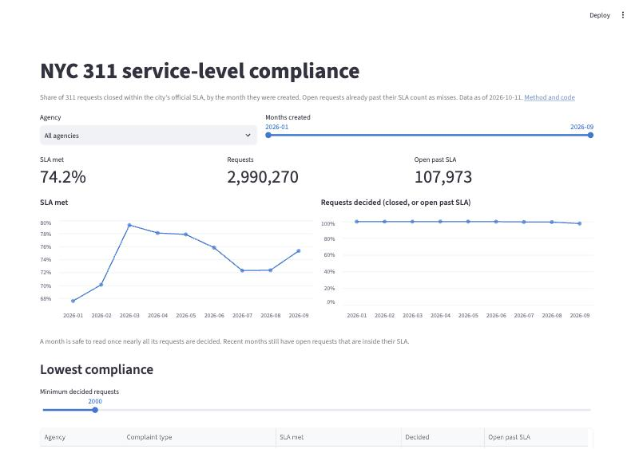

# NYC 311 Pipeline

A batch pipeline for NYC 311 service requests, built to answer one business question:

> **Which agencies miss their service-level targets, on which complaint types, and is it getting better or worse?**

It pulls each day's requests from the city's open-data API, lands the raw JSON in S3, converts it to typed, date-partitioned Parquet, and exposes it to Athena. dbt joins every request to the city's official SLA table and builds a monthly compliance mart, with data tests.

```
Socrata API ──ingest.py──▶ S3 raw/ (JSON) ──transform.py──▶ S3 curated/ (Parquet) ──▶ Athena table ──dbt──▶ marts

dbt:  stg_311_requests ─┐
                        ├─▶ fct_service_requests ─▶ mart_sla_compliance
      sla_official (seed) ─▶ stg_sla_targets ─┘      (one row per request)   (agency × complaint type × month)
```

Loaded for 2026-01-01 → 2026-09-30 (273 days, 2.99M requests). About 10,000 requests a day. One day of raw JSON is ~44.5 MB; the same day as Parquet is ~1.1 MB.

## Dashboard



`dashboard/app.py` is a Streamlit app with three views: the monthly compliance trend, the lowest-compliance agency and complaint types, and a drill-down for any one type.

**It reads a CSV, not Athena.** `export_mart.py` exports `mart_sla_compliance` (1,610 rows) to `dashboard/data/`. The public app then needs no AWS credentials, and a page view costs no Athena query. The mart is a monthly report, so re-exporting after each monthly build keeps it current.

**Rates are re-aggregated, never averaged.** When a view combines months or agencies, it sums the met and decided counts and divides again. Averaging `pct_met` across rows would weight a group of 10 requests the same as one of 10,000.

## Layout

| Path | What it does |
|---|---|
| `ingest.py` | Pulls one day from the API, page by page, into `s3://<lake>/raw/nyc311/dt=YYYY-MM-DD/` |
| `transform.py` | Reads one day of raw JSON, keeps 12 columns, casts types, removes invalid and duplicate rows, writes one Parquet file to `curated/` |
| `backfill.py` | Runs ingest + transform for a date range, one day at a time |
| `sql/create_curated_table.sql` | Athena DDL for the curated table, partitioned by `dt` |
| `dbt/models/staging/` | `stg_311_requests`: renames columns and derives `created_day` and `hours_to_close` |
| `dbt/seeds/sla_official.csv` | NYC's official 311 SLA table ([cs9t-e3x8](https://data.cityofnewyork.us/d/cs9t-e3x8)), stored as published |
| `dbt/models/staging/stg_sla_targets.sql` | Parses SLA text ("8 hours", "3 days") into hours, one row per complaint type and descriptor |
| `dbt/models/core/fct_service_requests.sql` | One row per request: its SLA, and whether it met it as of a fixed date |
| `dbt/models/marts/mart_sla_compliance.sql` | SLA compliance per agency, complaint type and month created, with the month-over-month change |
| `export_mart.py` | Exports the SLA mart from Athena to `dashboard/data/` |
| `dashboard/app.py` | Streamlit dashboard over the exported mart |
| `dbt/models/marts/` (others) | Daily volume, response times and HPD housing complaints by ZIP |

## Design decisions

**Raw and curated zones are kept separate.** Raw JSON is stored exactly as the API returned it. If the cleaning logic changes, curated data can be rebuilt from raw without calling the API again.

**Every run is idempotent.** Both scripts delete that day's existing files before writing. Rerunning a day replaces it instead of duplicating it, so a failed or partial day can simply be run again.

**Pagination uses a stable sort order.** Pages are requested with `$order=unique_key`. Without a fixed order, the API can return rows in a different order on each call, so offset-based pages could overlap or skip rows.

**Retries with exponential backoff.** API calls retry up to 5 times, waiting 2, 4, 8, 16 and 32 seconds, so a brief network or rate-limit error doesn't fail the whole day.

**Every run is reconciled.** Ingest compares the rows landed against the API's `count(*)` for that day. Transform asserts `raw = written + invalid + duplicates`. Rows are never dropped silently: if a number doesn't add up, the run says so.

**Parquet, partitioned by day.** Columnar storage with typed columns cuts storage about 40× and lets Athena read only the columns and days a query needs, which is what Athena bills on.

**dbt staging views, mart tables.** Staging models are views (no storage, always current). Marts are materialized as tables so dashboard queries are fast and cheap.

**Backfill logs failures instead of stopping.** A bad day is recorded and the backfill moves on. The run ends with a list of failed days to rerun.

**Monthly re-ingest, not change capture.** Requests close days or weeks after they are created, and a day ingested once never sees those closes. A closed-date stream with upserts would fix that daily, but the business question is a monthly report on requests old enough to judge. Re-ingesting a month once it has matured answers it with the existing idempotent backfill and no new infrastructure.

**Partition projection.** Athena derives the `dt` partitions from a rule in the table definition, so a day written to S3 is queryable at once with no `MSCK REPAIR TABLE` step.

## Measuring SLA compliance

The obvious query, `closed_date - created_date <= sla`, gives the wrong answer in three ways:

| Request | Created | Closed | SLA | `closed - created` | Naive result | Correct result |
|---|---|---|---|---|---|---|
| A | Aug 1 | Aug 3 | 7 d | 2 d | met | met |
| B | Aug 1 | *open* | 7 d | NULL | **dropped** | missed: 70+ days old |
| C | Oct 9 | *open* | 7 d | NULL | **dropped** | pending: too early to judge |
| D | Aug 1 | Jul 30 | 7 d | −2 d | **met** | invalid: flagged, excluded |

Dropping B is survivorship bias: the slowest requests are the ones still open, so leaving them out inflates compliance. The fact table gives every request one outcome instead:

| `sla_outcome` | Meaning |
|---|---|
| `met` / `missed` | Closed within / after its SLA |
| `missed_open` | Still open and already past its SLA, so it can no longer meet it |
| `pending` | Still open, not yet past its SLA |
| `no_sla` | No official SLA for this complaint type (9.4% of requests) |
| `not_tracked` | The agency never closes this type (helicopter noise, construction lead dust) |
| `invalid` | Closed before it was created, or marked Closed with no close date |

`pct_met = met / (met + missed + missed_open)`. `pct_decided` shows how much of a month can be judged yet; a month is safe to read once it is close to 100%.

**SLA targets come from the city, not from me.** The official table goes one level deeper than the request data, so each request is matched on complaint type and descriptor first (87%), then on complaint type alone, taking the longest SLA so agencies are never held to a stricter target than the city sets. Requests with no match are excluded and counted, not given an invented default.

**One as-of date for every partition.** Months were ingested on different days. Every request is viewed as of `as_of_date` (a dbt var): a close after that moment counts as not yet closed, so all months are measured from the same point in time.

**Never-closed complaint types.** Helicopter noise showed 0% compliance with every request open. An agency that closes nothing for three months is not missing its SLA; it does not track closure for that type. Types where ≥99% of requests older than 90 days are still open are marked `not_tracked`, not counted as failures. Types that close some requests but are badly behind (e.g. DPR tree work, 65% open) stay in as real misses.

## Results (requests created Jan–Sep 2026, as of 2026-10-11)

| Month | Requests | SLA met | Decided |
|---|---|---|---|
| Jan | 348,511 | 67.6% | 100% |
| Feb | 334,691 | 70.1% | 100% |
| Mar | 342,390 | 79.3% | 100% |
| Apr | 302,190 | 78.1% | 100% |
| May | 331,980 | 77.9% | 100% |
| Jun | 334,834 | 75.8% | 99.9% |
| Jul | 343,133 | 72.3% | 99.5% |
| Aug | 328,914 | 72.3% | 99.3% |
| Sep | 323,627 | 75.3% | 97.6% |

Compliance is lowest in January and February, the heat and snow season, and dips again in July–August.

Lowest compliance among high-volume complaint types (Jan–Aug, ≥20,000 decided requests):

| Agency | Complaint type | SLA met |
|---|---|---|
| DHS | Homeless person assistance | 17.8% |
| HPD | Unsanitary condition | 23.0% |
| HPD | Water leak | 23.8% |
| HPD | General | 26.4% |
| HPD | Door/window | 29.8% |
| DSNY | Snow or ice | 35.9% |

Housing-condition complaints to HPD dominate the list: their official SLAs are 1–8 days, and about three in four miss them.

## Data tests

- `request_id` is unique and not null, in staging and in the fact table. In the fact table this also catches a join to the SLA table that fans one request out into several rows.
- Every month from January to the as-of date has at least 250,000 rows. Row-level tests pass on a table that is missing whole partitions; this one does not.
- The SLA table has one row per join key, and every SLA is positive.
- `sla_outcome` takes only the values above, and `pct_met` / `pct_decided` stay between 0 and 1.
- Warnings, not failures: SLA coverage below 85% (currently 90.6%), invalid durations above 1% (currently 0.03%).

## Finding: dbt tests passed on 1% of the data

The Athena table had only three partitions registered, for 2026-09-20 to 09-22. Every other day was in S3 but invisible to queries, so the first version of the marts described three days, and every dbt test passed. Unique and not-null tests check the rows that are there, not whether rows are missing. Partition projection fixed the cause, and the month-completeness test now guards against it.

## Finding: average resolution time is biased low

`agency_response_times` averages time to close over closed requests only. The still-open requests are the slow ones, so the average understates real waiting time. `mart_sla_compliance` measures the same thing without the bias by counting open requests that are past their SLA as misses.

## Known limitations and next steps

- **One as-of date.** All partitions share one `as_of_date`, which must be no later than the earliest ingestion. The next step is an `ingested_at` column written by `transform.py`, so each row carries its own.
- **The SLA table is dated.** The city last updated it in March 2024, and it is matched by text. Renamed complaint types fall into `no_sla` and lower coverage, which the coverage test would flag.
- **Median time to close** in the mart uses closed requests only. `pct_met` is the unbiased measure; the median is a supporting number.
- **Offset pagination on live data.** If the city adds or edits records for a day while it is being ingested, offsets can shift. The count reconciliation detects this, and a rerun fixes it.
- **Infrastructure is not in this repo.** The S3 buckets, Athena workgroup and Glue database were created separately.

## Running it

```bash
python -m venv .venv && source .venv/bin/activate
pip install -r requirements.txt

python ingest.py --date 2026-09-20
python transform.py --date 2026-09-20
python backfill.py --start 2026-01-01 --end 2026-09-30

cd dbt && dbt seed --profiles-dir . && dbt build --profiles-dir . && cd ..
python export_mart.py
streamlit run dashboard/app.py
```

The pipeline and export require AWS credentials with access to the lake bucket and Athena workgroup named in the scripts and `dbt/profiles.yml`.
